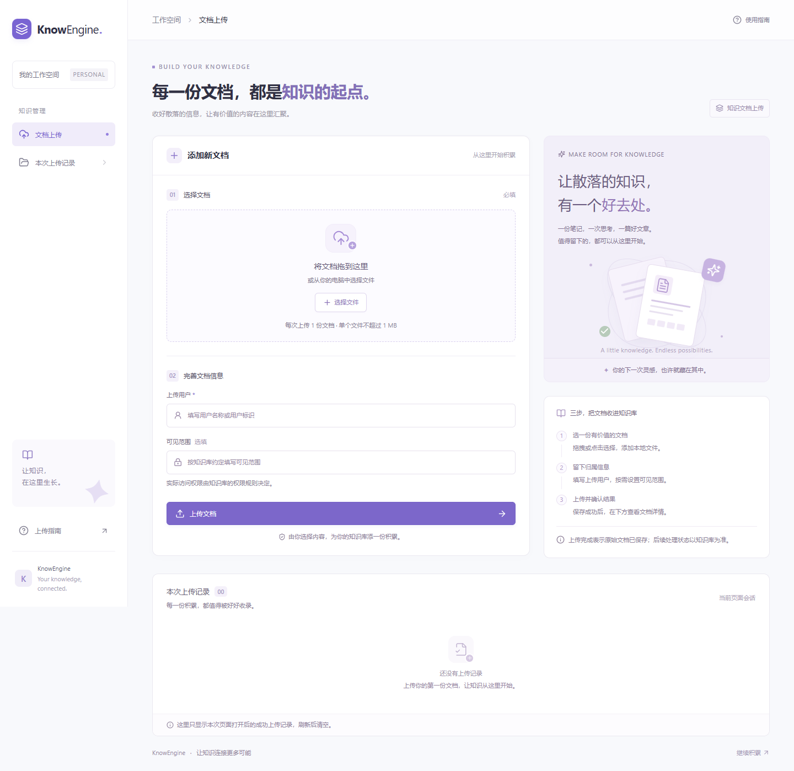

# KnowEngine 知识文档上传

独立的 React + TypeScript 单页前端，使用 Vite、Axios、Tailwind CSS 和 Lucide 图标。仅实现知识文档上传，不包含聊天页或 SSE。

## 本地启动

需要 Node.js 20.19+ 或 22.12+（建议使用本机 Node.js 24）。

```powershell
cd D:\MyCode\know-engine\know-engine-frontend
npm install
npm run dev
```

打开 <http://127.0.0.1:5173>。开发服务器将 `/api` 代理到 `http://localhost:8080`，后端须单独启动，MinIO 和数据库也须可用。前端不会自动启动或修改后端。

## 接口约定

`POST http://localhost:8080/api/knowledge/documents/upload`

使用浏览器 `FormData` 发送 `multipart/form-data`，不手动设置 `Content-Type`，让浏览器生成 boundary。

| 字段 | 类型 | 规则 |
| --- | --- | --- |
| `file` | File | 必填，每次一份，拒绝空文件与超过配置上限的文件 |
| `uploadUser` | string | 必填，提交前去掉首尾空白 |
| `accessibleBy` | string | 可选，去掉首尾空白；为空时不提交该字段 |

响应直接读取 `KnowledgeDocument`，不假设有 `code` / `data` 包装层。展示 `docId`、`docTitle`、`uploadUser`、`docUrl`、`status`、`accessibleBy`。可见范围的字符串含义及权限由后端定义，前端不虚构 `public` / `private` 值。

发送进度达到 100% 时仍等待服务器响应，只有返回有效文档信息才展示成功。支持取消等待、失败重试和 HTTP(S) 原文件链接。取消请求、网络断开或超时不能保证后端没有保存；重试前需核对保存结果。后端目前没有幂等上传约定。

“本次上传记录”只记录当前页面内成功返回的上传，不查询历史列表、不持久化到浏览器；刷新后清空。上传完成不等于转换、分片或向量化完成。

## 可选配置

将 `.env.example` 复制为 `.env.local` 后修改，修改后重启 Vite：

```dotenv
VITE_API_BASE_URL=/api
API_PROXY_TARGET=http://localhost:8080
VITE_MAX_UPLOAD_MB=1
```

默认单文件上限 1 MB，与未另行配置时的 Spring Boot 默认上限保持一致。若后端调大 `spring.servlet.multipart.max-file-size`，请同时调大 `spring.servlet.multipart.max-request-size`，并同步这里的限制。前端不限制扩展名，最终允许的文件格式由后端决定。

生产构建：

```powershell
npm run build
npm run preview
```

`dist/` 为静态产物。Vite 的代理只在开发模式生效，生产和 `preview` 需要由反向代理把 `/api` 转发到后端；也可以在构建前将 `VITE_API_BASE_URL` 配成实际后端地址，并在后端配置 CORS。不要在前端环境变量中放任何密钥。

## 验证

```powershell
npm run build
npm run test:e2e
```

浏览器测试默认使用本机 Microsoft Edge，支持通过环境变量 `PLAYWRIGHT_CHANNEL=chrome` 切换到已安装的 Chrome。测试拦截上传接口，验证必填与文件校验、multipart 参数、成功详情、失败重试、取消、网络错误、链接安全及 320/390/768/1440px 布局。它们不证明 MinIO 或数据库已联通。

本次验证：生产构建通过，9 项浏览器测试通过。2026-10-21 使用 `tests/fixtures/knowledge-sample.txt` 向本机实际上传接口完成一次联调，返回 HTTP 200、`docId=1`、`status=UPLOADED`。这条测试记录已保留在后端，上传用户为 `frontend-integration-test`；未调用删除接口。开发代理的 OPTIONS 请求也已成功到达后端。

设计稿：[KnowEngine · 知识文档上传](https://www.figma.com/design/3GERMfOI7MZOZWMSS4dWE1?node-id=2-357)。Figma 中保留可编辑的分区、文字、复用控件及颜色变量；页面实现同时遵循 Visualize 对主要操作、真实状态、响应式和可访问性的设计原则。设计稿为布局参考，以实际运行的前端为准。



手机端截图见 [docs/upload-mobile.png](docs/upload-mobile.png)，Figma 设计稿预览见 [docs/figma-design.png](docs/figma-design.png)。

参考官方文档：[Vite](https://vite.dev/guide/)、[Tailwind CSS Vite 集成](https://tailwindcss.com/docs/installation/using-vite)、[Axios multipart](https://axios-http.com/docs/multipart)。
